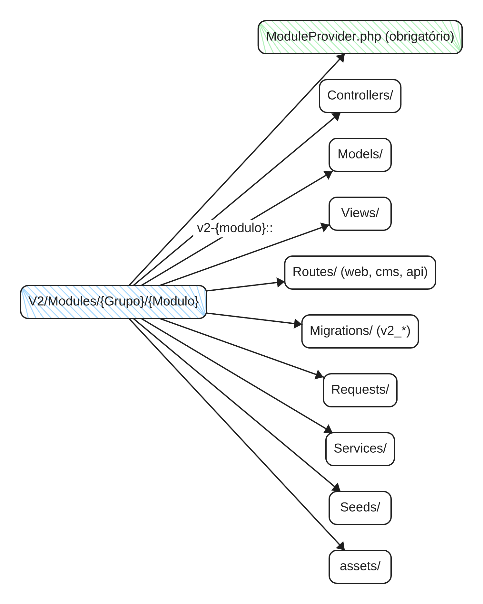
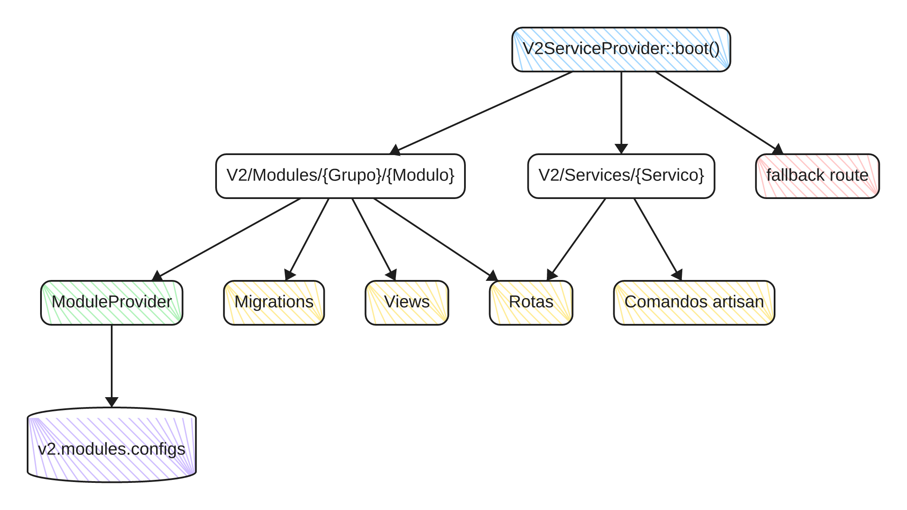
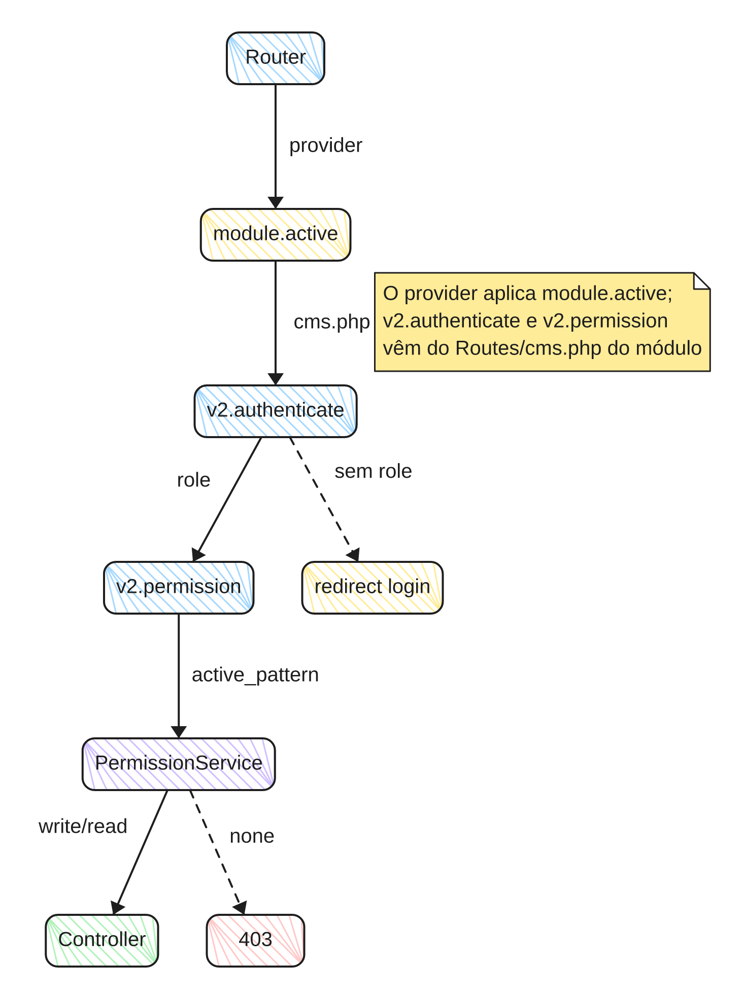
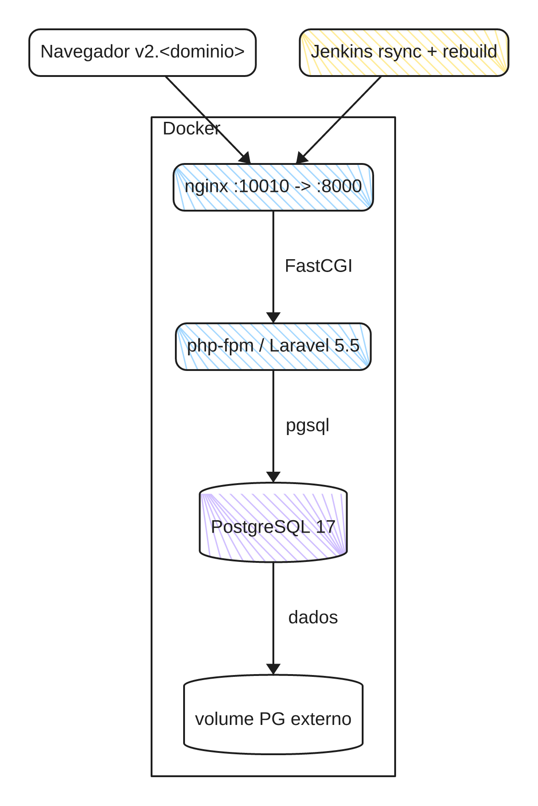

# Diagramas reais

Os quatro diagramas abaixo são projetos de verdade escritos em `.akrc`: nenhum nó tem coordenada,
tudo é topologia e rótulo. Eles estão em `fixtures/reais/` e são a regressão de renderização do
repositório — `crates/akribie-core/src/layout/overlap_tests.rs` afirma, sobre eles, que nenhum
rótulo encosta em nó, em outro rótulo ou na borda do canvas, e que o título de grupo cabe inteiro
dentro do grupo.

## Anatomia de um módulo V2



Os diretórios que o `V2ServiceProvider` reconhece dentro de `V2/Modules/{Grupo}/{Modulo}`
e o que cada um vira: provider, controllers, models, views, rotas, migrations, requests, services,
seeds e `assets/`.

```akrc
chart v1 "Anatomia de um módulo V2" direction=lr doc="README.md#anatomia-modulo" font=sans lang=pt-BR layout=tree sketch=off

node mod "V2/Modules/{Grupo}/{Modulo}" fill=blue
node prov "ModuleProvider.php (obrigatório)" fill=green
node ctl "Controllers/" fill=paper
node mdl "Models/" fill=paper
node vw "Views/" fill=paper
node rt "Routes/ (web, cms, api)" fill=paper
node mig "Migrations/ (v2_*)" fill=paper
node req "Requests/" fill=paper
node srv "Services/" fill=paper
node seed "Seeds/" fill=paper
node ast "assets/" fill=paper

edge mod -> prov
edge mod -> ctl
edge mod -> mdl
edge mod -> vw "v2-{modulo}::"
edge mod -> rt
edge mod -> mig
edge mod -> req
edge mod -> srv
edge mod -> seed
edge mod -> ast
```

## Boot e auto-descoberta



No boot, o `V2ServiceProvider` varre `V2/Modules/{Grupo}/{Modulo}` e `V2/Services/{Servico}`; de
cada módulo saem migrations, views e rotas, de cada serviço saem rotas e comandos artisan, e a rota
de fallback é registrada por último.

```akrc
chart v1 "Boot da V2 — auto-descoberta" direction=tb doc="README.md#boot-descoberta" font=sans lang=pt-BR layout=flow sketch=off

node boot "V2ServiceProvider::boot()" fill=blue
node modules "V2/Modules/{Grupo}/{Modulo}" fill=paper
node services "V2/Services/{Servico}" fill=paper
node prov "ModuleProvider" fill=green
node cfg "v2.modules.configs" fill=violet shape=cylinder
node mig "Migrations" fill=amber
node views "Views" fill=amber
node rots "Rotas" fill=amber
node fallback "fallback route" fill=red
node cmds "Comandos artisan" fill=amber

edge boot -> modules
edge boot -> services
edge modules -> prov
edge prov -> cfg
edge modules -> mig
edge modules -> views
edge modules -> rots
edge services -> rots
edge services -> cmds
edge boot -> fallback
```

## Pipeline CMS e resolução de permissão



A ordem real dos middlewares numa rota `/cms/*` e como a permissão é resolvida até o controller:
`v2.authenticate` declara `v2.permission` dentro do `cms.php` de cada módulo.

```akrc
chart v1 "Pipeline CMS e resolução de permissão" direction=tb doc="README.md#pipeline-cms-rbac" font=sans lang=pt-BR layout=flow sketch=off

node router "Router" fill=blue
node flag "module.active" fill=amber
node authn "v2.authenticate" fill=blue
node perm "v2.permission" fill=blue
node ps "PermissionService" fill=violet
node ctl "Controller" fill=green
node deny "403" fill=red
node login "redirect login" fill=amber

edge router -> flag "provider"
edge flag -> authn "cms.php"
edge authn -> perm "role"
edge authn -> login "sem role" style=dashed
edge perm -> ps "active_pattern"
edge ps -> ctl "write/read"
edge ps -> deny "none" style=dashed

note "O provider aplica module.active; v2.authenticate e v2.permission vêm do Routes/cms.php do módulo" near=flag
```

## Topologia de execução



Navegador → nginx → php-fpm → PostgreSQL, dentro do host Docker, mais o Jenkins que publica por
rsync e reinicia a estrutura.

```akrc
chart v1 "Topologia de execução" direction=tb doc="README.md#topologia-runtime" font=sans lang=pt-BR layout=flow sketch=off

group docker "Docker" fill=paper

node nginx "nginx :10010 -> :8000" fill=blue in=docker
node php "php-fpm / Laravel 5.5" fill=blue in=docker
node pg "PostgreSQL 17" fill=violet in=docker shape=cylinder
node vol "volume PG externo" fill=paper in=docker shape=cylinder
node browser "Navegador v2.<dominio>" fill=paper
node jenkins "Jenkins rsync + rebuild" fill=amber

edge browser -> nginx
edge nginx -> php "FastCGI"
edge php -> pg "pgsql"
edge pg -> vol "dados"
edge jenkins -> nginx
```

## Como reproduzir

Na raiz do repositório:

```sh
akr render fixtures/reais/<nome>.akrc --format png --scale 2 --out docs/exemplos/img/<nome>.png
for f in fixtures/reais/*.akrc; do akr check --strict "$f"; done
```

`akr check` aceita um arquivo por vez; `--strict` promove qualquer aviso a erro. Os `.akrc` são a
fonte: o PNG e o SVG são derivados, nunca editados à mão.
