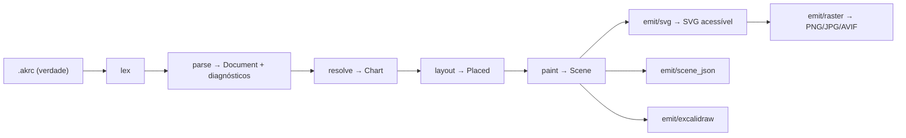

# Panorama

`akr` compila um arquivo-texto de topologia (`.akrc`) em diagramas determinísticos: SVG acessível por
padrão, PNG/JPG/AVIF sob demanda, `scene` JSON para depuração e `.excalidraw` para interop.

Binário único, 100% local, offline. Sem daemon, sem banco, sem rede em tempo de execução. O usuário é
um LLM ou um agente: ele escreve **o que existe e como se liga**; o binário calcula geometria, cor,
texto alternativo e bytes.

## O que o usuário escreve

```akrc
chart v1 "Política de retry" direction=lr layout=flow theme=paper lang=pt-BR

node api "API Gateway" fill=blue shape=rounded
node retry "Retry ×3" fill=amber shape=cloud
node dlq "DLQ" fill=red shape=cylinder

edge api -> retry "5xx"
edge retry -> api "backoff" curve=arc style=dashed
edge retry -> dlq "esgotado" style=dashed
```

## O que o binário faz



Seis estágios, cada um uma função pura sobre dados. I/O atravessa quatro portas (`Fs`, `Git`, `Env`,
`Logger`); só a CLI monta as implementações reais. Nenhum estágio consulta relógio, ambiente ou hash
map — o determinismo é estrutural, não um acordo.

## Artefatos

| artefato | extensão | contrato |
|---|---|---|
| `.akrc` | fonte | versionado; forma canônica por `akr fmt` |
| SVG | `.svg` | bytes estáveis entre execuções e versões |
| `scene` | `.json` | bytes estáveis; geometria pronta para emitir |
| Excalidraw | `.excalidraw` | derivado determinístico; interop |
| raster | `.png`/`.jpg`/`.avif` | determinístico na versão; não é contrato entre versões |

## Escopo

**Dentro:** fluxograma, árvore, mapa mental, grade, pilha, layout livre; nó/aresta/grupo/nota; nove
formas; quatro estilos de preenchimento; dois temas; SVG acessível; lote por JSONL; diff semântico;
interop Excalidraw; MCP.

**Fora da v1:** gráficos de dados (barra/linha/pizza), edição interativa, servidor, colaboração,
export PDF, animação, tema definido pelo usuário, fontes do sistema.

## Princípios de projeto

1. Simplicidade primeiro: infraestrutura paga por si no caso local.
2. Determinismo é contrato: mesma entrada + mesma versão ⇒ mesmos bytes.
3. Portas e fakes: o domínio nunca toca o sistema operacional.
4. Rigor de processo: `make check` é o portão único.
5. Documentação é entregável: superfície, docs e testes no mesmo passo.
